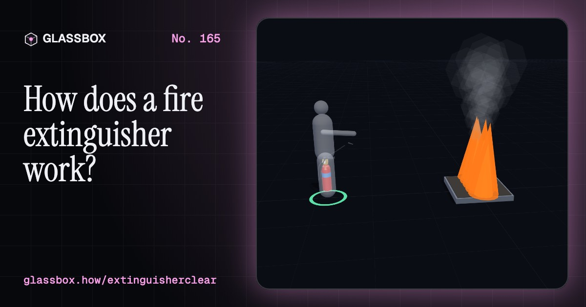
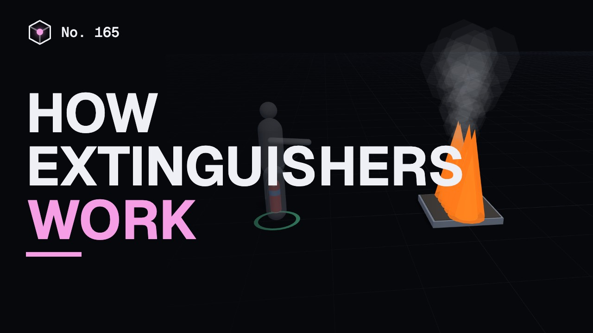
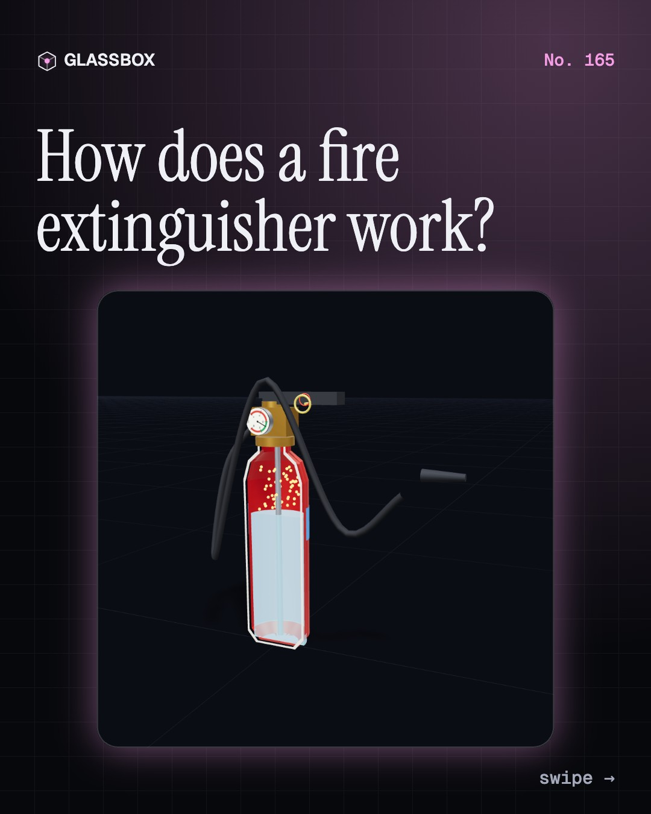
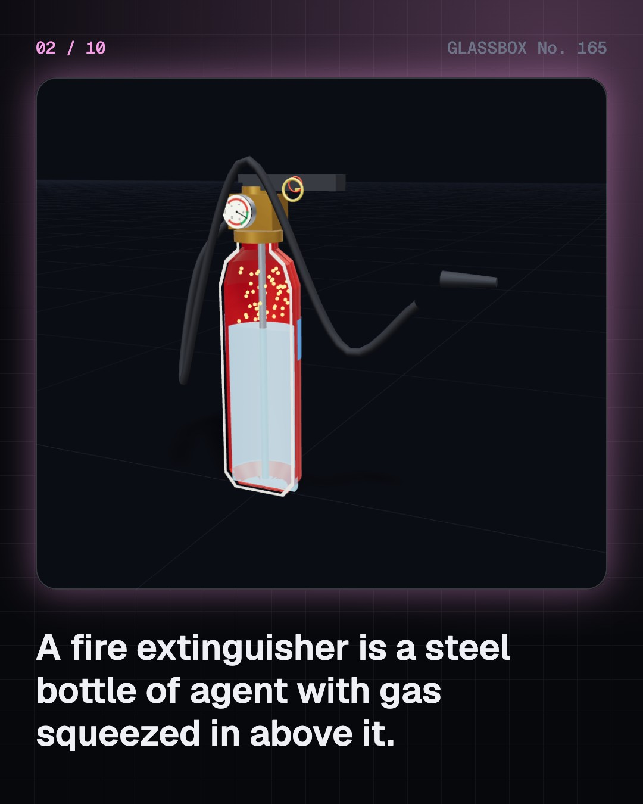
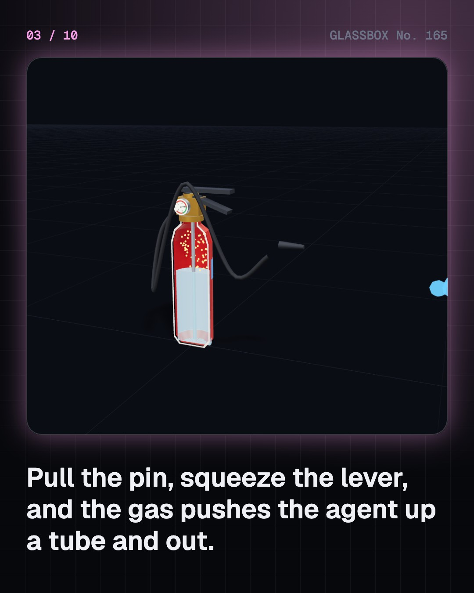
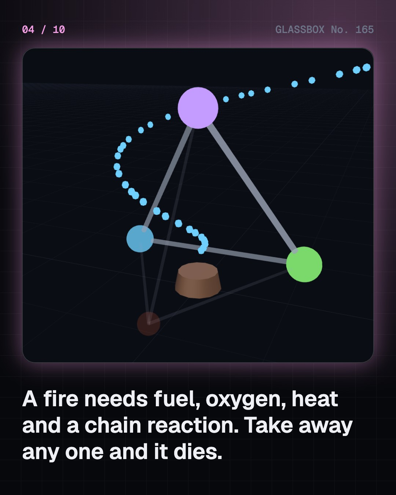

<!-- glassbox:start -->
<!-- Generated from glassbox.json by the Glassbox hub (npm run readme -- extinguisherclear). Edit glassbox.json, not this block. -->
<p align="center"><a href="https://glassbox.how/e/extinguisherclear/"></a></p>

<h1 align="center">ExtinguisherClear</h1>

<p align="center"><b>How does a fire extinguisher work?</b><br>A fire extinguisher is a steel bottle of gas pushing on an agent, and the agent only works because it removes one of the four things a fire needs. Pull the pin, learn why you aim at the base, and see why water on cooking oil makes a fireball.</p>

<p align="center"><a href="https://glassbox.how/extinguisherclear/"><b>▶ Play with it</b></a> &nbsp;·&nbsp; <a href="https://glassbox.how/e/extinguisherclear/">Read the 60-second explainer</a> &nbsp;·&nbsp; <a href="https://glassbox.how/extinguisherclear/glassbox/reel.mp4">Watch the 40-second video</a></p>

<p align="center">
  <a href="https://glassbox.how/e/extinguisherclear/"></a>
  <a href="https://glassbox.how/e/extinguisherclear/"></a>
  <a href="LICENSE"></a>
  <a href="LICENSE-CONTENT.md"></a>
  <a href="#privacy"></a>
</p>

## In 60 seconds

1. **A bottle of gas pushing on an agent.** A stored-pressure extinguisher is a cylinder with the agent (water, foam or powder) at the bottom and nitrogen or dry air above it at about 12 to 15 bar. Squeeze the lever and the gas pushes the agent up a dip tube, along the hose and out of the nozzle. As the agent leaves, the gas gets more room and its pressure falls (Boyle's law), so the jet weakens. A water extinguisher lasts about a minute, a powder one about 20 seconds.
2. **A fire needs four things.** The fire triangle is fuel, oxygen and heat. Fire engineers add a fourth corner, the chain reaction inside the flame. Take away any one and the fire dies. Water mostly removes heat: warming a litre and boiling it away absorbs about 2.6 MJ. CO₂ pushes oxygen away. Foam keeps fuel vapour apart from the air. Dry powder breaks the chain reaction. Wet chemical cools hot cooking oil and turns the top into soap.
3. **PASS: aim at the base.** Pull the pin, Aim at the base, Squeeze the lever, Sweep side to side. Flames are only burning gas rising from the fuel, so agent thrown at the flames flies through them. The stream is a thin beam, and flames creep back across any strip you skip. Gravity and air drag bend the jet, so range is a few metres: stand about two metres back, and leave if it is not winning.
4. **The wrong extinguisher makes it worse.** Fires are sorted by fuel: A solids, B liquids, C gases, D metals, F cooking oil (K in the US). Water on cooking oil sinks, flashes to steam more than 1,700 times its volume and throws burning oil in a fireball. Water on petrol spreads it. Water on a live appliance carries current. Water on burning magnesium makes hydrogen. Check the label for the classes it is rated for.
5. **CO₂: a liquid that boils into snow.** A CO₂ extinguisher holds liquid carbon dioxide at its own vapour pressure: about 57 bar at 20 °C and 35 bar at 0 °C. While any liquid is left, the pressure depends only on temperature, so a gauge cannot show how full it is and the cylinder is weighed instead. Released, the liquid boils into freezing gas and snow, about 540 litres of gas per kilogram. Never hold the horn.
6. **Ready when you need it.** The gauge needle should sit in the green. Low gas means a short, weak spray even from a full cylinder, and a slow leak is a common failure. Gas pressure also follows temperature. A broken tamper seal means it may have been used. Typical practice is a monthly look, a yearly service by a competent person and a deeper overhaul and pressure test every 5 to 12 years. Check your local rules.

## Words worth knowing

| Term | Meaning |
|---|---|
| **Agent** | The stuff in an extinguisher that puts the fire out: water, foam, powder, CO₂ or a wet chemical. |
| **Stored pressure** | A design where the agent and its pushing gas are sealed in one cylinder from the day it is filled. |
| **Dip tube** | The pipe from the valve nearly to the bottom, so the gas pushes the agent up and out. |
| **Boyle's law** | At constant temperature, a gas's pressure times its volume stays the same. |
| **Fire tetrahedron** | Fuel, oxygen, heat and the chain reaction: the four things a flame needs together. |
| **PASS** | Pull the pin, Aim at the base, Squeeze the lever, Sweep side to side. |
| **Fire class** | A label by fuel: A solids, B liquids, C gases, D metals, F cooking oil (K in the US). |
| **Vapour pressure** | The pressure a liquid's own vapour makes in a closed container, rising steeply with temperature. |
| **Tamper seal** | A thin tie through the pin that breaks when the pin is pulled. |
| **Hydrostatic test** | Filling the empty cylinder with water at high pressure to prove the metal is still strong enough. |

## A short history

**2,300 years from a Greek force pump to a red cylinder you can find in the smoke.**

- **270 BCE** · A pump that throws a jet (Ctesibius, Alexandria, Egypt)
- **1723** · The first patent for a fire extinguisher (Ambrose Godfrey, London, England)
- **1816** · The Extincteur: a portable pressurised vessel (George William Manby, England)
- **1866** · Soda and acid make their own pressure (François Carlier, France)
- **1871** · The Harden Star grenade (S. F. Harden and Co., New York, USA)
- **1904** · Foam for oil fires (Aleksandr Loran, Baku, Russian Empire (now Azerbaijan))
- **1910** · Carbon tetrachloride in the car (The Pyrene Company, United States)
- **1921** · The first NFPA standard for portable extinguishers (National Fire Protection Association, United States)

The full story, with 32 moments, charts, people and 26 sources: [glassbox.how/e/extinguisherclear/history](https://glassbox.how/e/extinguisherclear/history/). The data lives in [`history.json`](history.json).

## Video and slides

Made with the Glassbox studio from this box's storyboard (`window.glassbox.director`). Free to reuse under CC BY 4.0.

<a href="https://glassbox.how/extinguisherclear/glassbox/video.mp4"></a>

<p><a href="glassbox/slide-1.jpg"></a> <a href="glassbox/slide-2.jpg"></a> <a href="glassbox/slide-3.jpg"></a> <a href="glassbox/slide-4.jpg"></a></p>

| File | What | Size |
|---|---|---|
| [`glassbox/reel.mp4`](https://glassbox.how/extinguisherclear/glassbox/reel.mp4) | Reel / Short, with captions and soundtrack | 1080×1920 |
| [`glassbox/video.mp4`](https://glassbox.how/extinguisherclear/glassbox/video.mp4) | YouTube video, with captions and soundtrack | 1920×1080 |
| `glassbox/slide-1…10.jpg` | Instagram carousel | 1080×1350 |
| `glassbox/thumb.jpg` | YouTube thumbnail | 1280×720 |
| `glassbox/cover.jpg` | Share card and repo social preview | 1200×630 |
| [`glassbox/history-reel.mp4`](https://glassbox.how/extinguisherclear/glassbox/history-reel.mp4) | “History in 10 moments” Reel / Short | 1080×1920 |
| `glassbox/history-slide-*.jpg` | History carousel | 1080×1350 |
| `glassbox/post.json` | Post copy and schedule used by the publish kit | |

## Privacy

This box has no accounts and no ads, and it ships its own fonts and libraries. When you run it yourself it sends nothing anywhere. On glassbox.how, the site's `/bar.js` also loads Glassbox's analytics: **Google Analytics** to count visits (it asks first in the EU, UK and Switzerland, and stays off when your browser sends Global Privacy Control or Do Not Track) and **ClickTrust** to detect bots.

It remembers a few things **in your own browser only**, and never sends them anywhere:

| Browser storage key | What it holds |
|---|---|
| `extinguisherclear.v1` | Which chapters you have opened, your best quiz scores, and sound on or off. |

Exactly what each one sees is at [glassbox.how/privacy](https://glassbox.how/privacy/).

## Licences

- **Code:** [MIT](LICENSE). Use it, change it, ship it.
- **Explanations, text, images and videos** (`glassbox.json`, `glassbox/`): [CC BY 4.0](LICENSE-CONTENT.md). Credit “Glassbox, glassbox.how/e/extinguisherclear”.
- **Third-party parts** keep their own licences: [three.js](https://threejs.org) (MIT), [Geist, Instrument Serif](https://openfontlicense.org) (SIL OFL 1.1).
- The Glassbox name and logo aren't covered by either licence. See the [terms](https://glassbox.how/terms/).

Found a mistake? [Open an issue](https://github.com/bdeeps/extinguisherclear/issues). Corrections happen in public.
<!-- glassbox:end -->

## Run it

It's plain HTML, CSS and JavaScript. No build step and no dependencies. Run locally, it contacts no other website.

```bash
python3 -m http.server 8000
```

Three.js and the fonts ship in `vendor/` and `fonts/`, so it also works offline.

Then open http://localhost:8000.

## How it's built

| File | What |
|---|---|
| `index.html`, `css/app.css` | The page and its styles |
| `js/app.js`, `js/stage.js`, `js/ui.js`, `js/kit.js` | The shared Glassbox 3D engine: chapters, 3D stage, controls, quiz, video director |
| `js/chapters/*.js` | One file per chapter: the 3D model, controls, text, key terms, quiz and video scenes |
| `glassbox.json` | Title, question, explainer beats, key terms, browser storage and credits shown on glassbox.how |
| `reel` in each chapter | The storyboard the Glassbox studio records into short videos |
| `glassbox/` | The published video, slides, thumbnail and post copy |
| `fonts/`, `vendor/three/` | Self-hosted Geist and Instrument Serif (SIL OFL 1.1) and three.js (MIT) |
